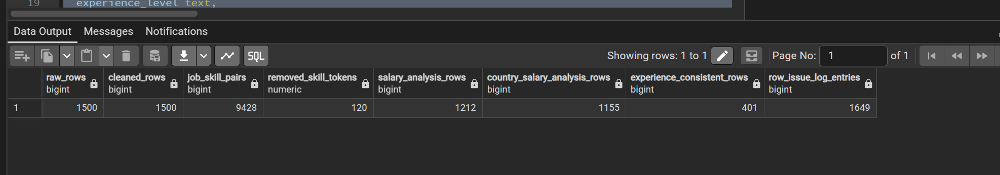
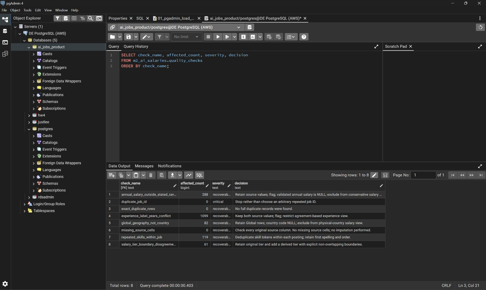
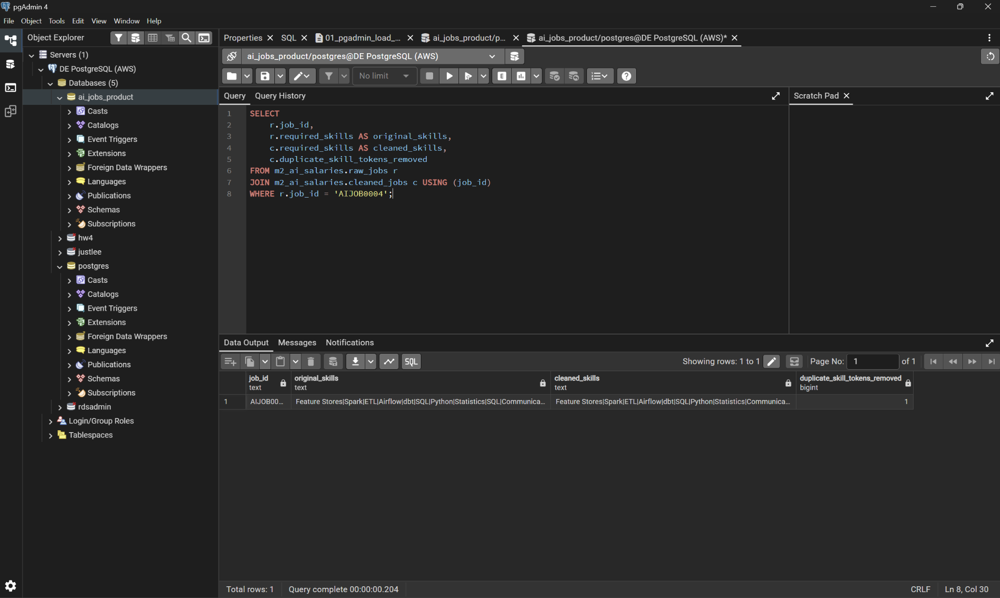

# AI Jobs Market Salaries

Data Engineering 95-815 · Group 2 · Tina Joshi

This repository contains my salaries-dataset contribution to the AI job-market project: the original Kaggle source, PostgreSQL ingestion and initial cleaning, reproducible Python processing, quality evidence, screenshots, and Milestone 2 report material.

The dataset has **1,500 records and 25 source columns**. The main cleaned table retains all 1,500 records. Repeated skills are removed within each job, while unresolved salary and experience conflicts remain visible through flags and a row-level issue log.

## Verified results

The SQL was run through pgAdmin against the existing AWS RDS PostgreSQL instance `de-postgres` in `us-east-2`, database **`ai_jobs_product`**, schema **`m2_ai_salaries`**. The screenshots below show the actual results from that database. Separate automated comparison against local PostgreSQL 16.2 matched all source strings and all 40 processed columns to the Python outputs.

| Metric | Result |
|---|---:|
| Original records | 1,500 |
| Cleaned records retained | 1,500 |
| Original columns / processed columns | 25 / 40 |
| Unique job-skill pairs | 9,428 |
| Distinct normalized skill keys | 93 |
| Repeated skill tokens removed | 120 across 119 jobs |
| Salary-consistent records | 1,212 |
| Records also eligible for country salary comparisons | 1,155 |
| Experience-consistent records | 401 |
| Row-level issue-log entries | 1,649 |

Issues overlap, so the issue-log count is not a count of distinct jobs. Cleaned records and filtered subsets are outputs of this one source, not additional independent datasets.

## Original data and source limitations

- **Source:** [AI Jobs Market 2025–2026 Salaries on Kaggle](https://www.kaggle.com/datasets/alitaqishah/ai-jobs-market-2025-2026-salaries), published by Syed Ali Taqi.
- **Version:** 1, released March 6, 2026.
- **Original file:** [raw/ai_jobs_market_2025_2026.csv](raw/ai_jobs_market_2025_2026.csv), 383,900 bytes.
- **Coverage in the file:** January 2025–March 2026; 25 role titles; 14 country labels including `Global` (13 physical countries).
- **License reported by the publisher:** CC0 Public Domain. See [DATA_SOURCE.md](DATA_SOURCE.md) and the original metadata snapshots in `raw/`.

The publisher describes a compilation of salary reports and job-market research. Individual original postings are not independently verified, and the file lacks employer names, original posting URLs, and full job descriptions. Course acceptance under the real-world-data requirement needs confirmation. Source-provided demand, growth, premium, and benefits scores do not have independently verified calculation methods. Findings describe this compiled sample; they do not establish market-wide trends, causal salary premiums, or ATS success. This CSV is a structured source and does not fulfill the separate semi-structured/unstructured requirement.

## Repository contents

| Location | Contents |
|---|---|
| [raw/](raw/) | Unchanged original CSV and download ZIP, publisher metadata, source version, and checksums |
| [sql/01_pgadmin_load_and_clean.sql](sql/01_pgadmin_load_and_clean.sql) | Self-contained SQL: original records, raw load, validation, cleaning, normalized skills, logs, and views |
| [sql/02_demo_and_verification_queries.sql](sql/02_demo_and_verification_queries.sql) | Read-only queries for inspecting results and recording the demo |
| [cleaned/](cleaned/) | Full cleaned CSV, normalized job-skill pairs, and the conservative salary subset |
| [scripts/](scripts/) | Reproducible Python cleaning and optional original-source download |
| [notebooks/AI_Jobs_Salaries_Cleaning_Executed.ipynb](notebooks/AI_Jobs_Salaries_Cleaning_Executed.ipynb) | Executed inspection, cleaning, examples, and reconciliation checks |
| [quality/](quality/) | Column profiles, aggregate checks, row-level log, summary, and before/after records |
| [evidence/](evidence/) | Actual pgAdmin screenshots and separate local PostgreSQL validation |
| [quality_log.md](quality_log.md) | Detailed issues, counts, decisions, and limitations |
| [query_outputs.txt](query_outputs.txt) | AWS results transcribed from the supplied screenshots, with the evidence basis identified |
| [pdf_section.md](pdf_section.md) | Report section for this dataset |
| [report/](report/) | Editable Word report, PDF, data dictionary, and detailed documentation |
| [video_notes.md](video_notes.md) | Suggested screen order and narration for this dataset's part of the five-minute team video |
| [START_HERE_PGADMIN.md](START_HERE_PGADMIN.md) | Detailed pgAdmin instructions and completed-load status |

## Reproduce in PostgreSQL with pgAdmin

Use an existing PostgreSQL server and a **fresh database or target schema**. No new AWS instance, Docker installation, Python installation, or server-side CSV file path is needed for this route.

1. In pgAdmin, select the target database and open **Query Tool**.
2. Open [sql/01_pgadmin_load_and_clean.sql](sql/01_pgadmin_load_and_clean.sql).
3. Execute the entire script once. All 1,500 original records are embedded in the SQL. The script needs permission to create the dedicated schema and its objects in that database.
4. Confirm the final `ingestion_summary` result matches the table above.
5. Refresh **Schemas → m2_ai_salaries** and inspect the tables and views.

The load script stops if its target tables already exist; it does not overwrite them. The populated AWS database has already been loaded. Use the read-only queries below when viewing or recording it. If a failed execution leaves an aborted transaction, run `ROLLBACK;` before investigating the original error.

```sql
SELECT * FROM m2_ai_salaries.ingestion_summary;

SELECT check_name, affected_count, severity, decision
FROM m2_ai_salaries.quality_checks
ORDER BY check_name;
```

Original source columns load as text without source-discarding constraints. Conversion and normalization occur in separate processed tables. The processed layer has appropriate types, a job primary key, and a composite job-skill key with a foreign key to the cleaned jobs. Critical invalid input stops the transaction; recoverable source conflicts are retained and flagged.

## Initial cleaning decisions

| Finding | Affected jobs | Handling |
|---|---:|---|
| Missing source cells | 0 | No imputation |
| Duplicate job IDs | 0 | Critical check passed; a repeated identifier would stop processing |
| Full duplicate source records | 0 | All source records retained |
| Repeated skills within a job | 119 | Remove 120 repeated tokens, retaining first spelling and order |
| Annual salary outside accompanying range | 288 | Keep source fields; flag; separate validated annual salary is NULL |
| Experience label disagrees with numeric years | 1,099 | Keep both fields; flag; use an agreement-based subset when needed |
| Salary-tier boundary disagreement | 61 | Keep original tier and add a separate explicitly derived tier |
| `Global` geography | 82 | Keep listing; leave physical-country code NULL; exclude physical-country comparison |

Salary-range conflicts do not prove the salary is wrong: the source does not establish whether the bounds refer to individual postings or general role benchmarks. No salary was clipped or replaced with a midpoint. Derived salary-tier boundaries are documented in [report/Data_Dictionary.md](report/Data_Dictionary.md). The derived posting period is the first day of the recorded month for grouping, not an observed exact posting date.

## Screenshot evidence

These are unchanged screenshots supplied by Tina from the AWS-connected pgAdmin session. No passwords or API keys are shown. [The screenshot manifest](evidence/screenshots/manifest.json) records their origins and hashes.

### Successful ingestion and reconciliation



### Quality checks and decisions



### Before and after skill cleaning

`AIJOB0004` repeats `SQL` in the original skill list. The processed list contains it once, and `duplicate_skill_tokens_removed` equals 1.



## Reproduce the Python outputs

Python is an additional reproducibility route. The actual AWS ingestion and cleaning were performed by SQL.

```bash
python -m pip install -r requirements.txt
python scripts/clean_and_profile.py
```

The script verifies the pinned original checksum and replaces only generated cleaned/quality outputs. Open the executed notebook in Jupyter or VS Code for the step-by-step examples. It can run from the repository root or `notebooks/` folder.

## Milestone 2 status and team integration

This contribution includes the salaries source, completed PostgreSQL ingestion, initial cleaning, quality logs, and report/demo material. The README does not claim that teammates' layoffs or Adzuna/MongoDB pipelines are implemented here. Cross-source integration and the final project analysis are separate team work. This source can support role/skill and location comparisons but has no employer identifier for joining to layoffs by company.

The team must assemble the combined three-to-four-page PDF, updated proposal, running meeting-notes link, and accessible narrated five-minute video. The actual recording and final combined submission are not included in this repository. Access by teammates to Tina's AWS database has not been verified.
